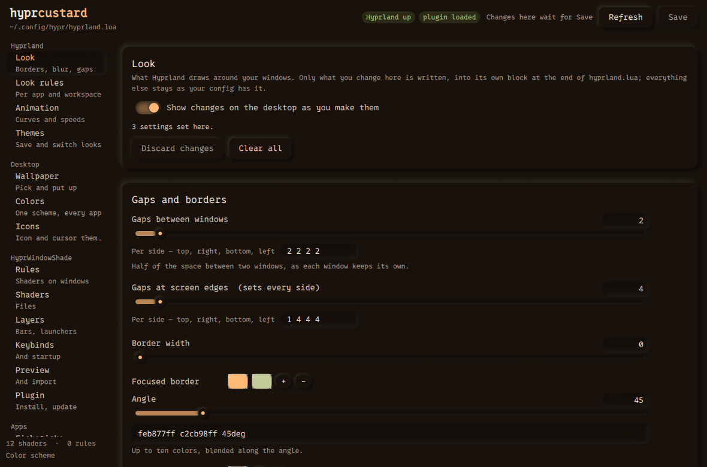
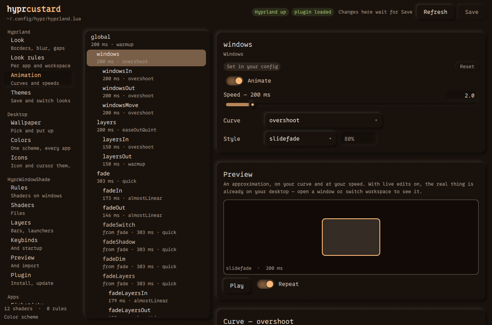
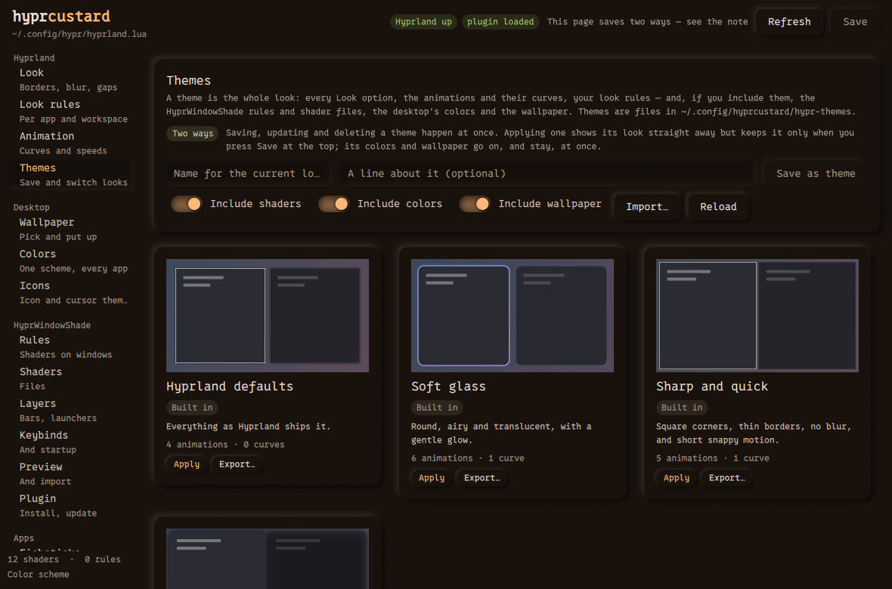
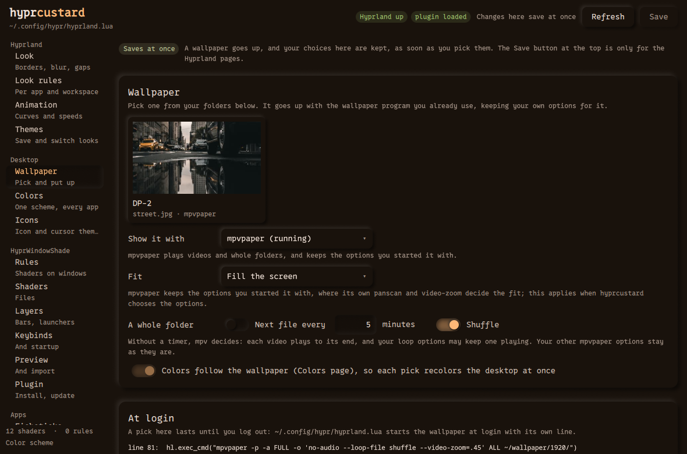
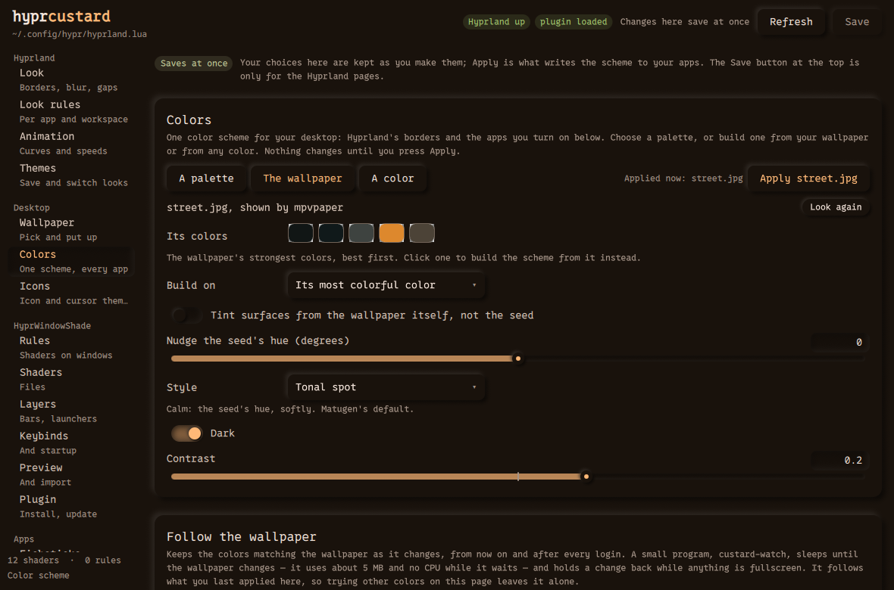
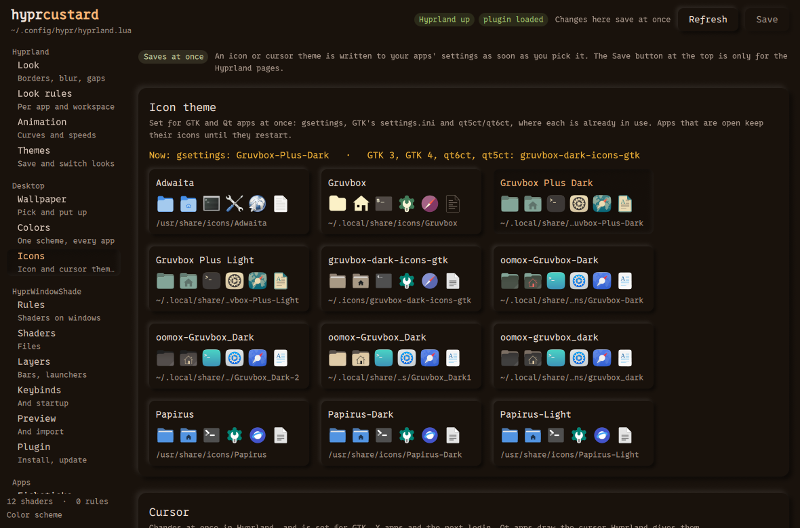
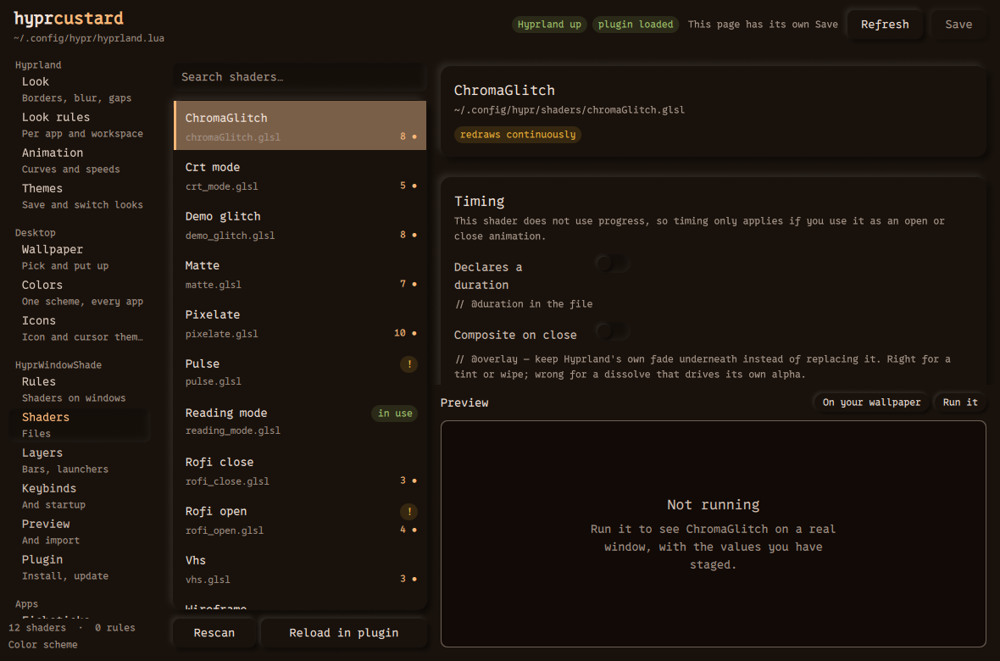

# hyprcustard

A theming app for Hyprland. Set how Hyprland looks and moves, save the result as a theme, pick
a wallpaper, and give your bar, launcher, terminal, notifications and GTK and Qt apps one color
scheme, all from one window, without hand-editing config files.



What you can do with it:

* **Hyprland's look**: gaps, borders and their gradients, rounding, opacity, dimming, shadow,
  glow and blur. Changes show on your desktop as you drag.
* **Look rules**: change the look for some windows, layers or workspaces only, such as a
  see-through terminal, blur behind the bar, or no gaps when a workspace has one window.
* **Animations**: every Hyprland animation, its speed, style and curve, with a curve editor and
  a preview.
* **Themes**: save the whole look under a name, switch between themes with one click, and share
  them as files.
* **Wallpaper**: browse your wallpapers and put one up, through the wallpaper program you
  already use.
* **Colors**: one color scheme, from a palette, your wallpaper or a color you pick, written for
  Hyprland, Waybar, Quickshell, Rofi, Dunst, kitty, Ghostty, Starship, and GTK and Qt apps. It can keep
  following your wallpaper as it changes.
* **Icons and cursors**: choose an icon theme and a cursor theme for every app at once.
* **Window shaders**: if you use the [HyprWindowShade](https://github.com/ManofJELLO/HyprWindowShade)
  plugin, set up its shaders on windows, bars and launchers, tune them with sliders, and preview
  them on a real window before you save.

hyprcustard edits your config in clearly marked blocks of its own, backs up every file before
it writes, and can undo each thing it does.

---

## Contents

- [Install](#install) · [What you need](#what-you-need)
- [First steps](#first-steps) · [How saving works](#how-saving-works) · [What it changes in your files](#what-it-changes-in-your-files)
- Hyprland: [Look](#look) · [Look rules](#look-rules) · [Animation](#animation) · [Themes](#themes)
- Desktop: [Wallpaper](#wallpaper) · [Colors](#colors) · [Icons](#icons)
- HyprWindowShade: [Rules and Layers](#rules-and-layers) · [Shaders](#shaders) · [Keybinds](#keybinds) · [Preview and import](#preview-and-import) · [Plugin](#plugin)
- [Fishsticks & Custard](#fishsticks--custard) · [Settings](#settings) · [Command line](#command-line)
- [Undoing things](#undoing-things) · [Good to know](#good-to-know)

---

## Install

### Arch Linux: the pacman repository

Signed packages are published for every release. Set it up once, and hyprcustard then updates
with the rest of your system.

1. Trust the packaging key:

   ```sh
   curl -sL https://raw.githubusercontent.com/ManofJELLO/hyprcustard/main/packaging/hyprcustard.asc \
     | sudo pacman-key --add -
   sudo pacman-key --lsign-key BA48547D9A95A6F8F421253B82ECC5B81415F831
   ```

2. Add the repository to `/etc/pacman.conf`:

   ```ini
   [hyprcustard]
   Server = https://github.com/ManofJELLO/hyprcustard/releases/download/repo
   ```

3. Install it:

   ```sh
   sudo pacman -Sy hyprcustard
   ```

Open it from your app launcher, or run `hyprcustard`.

### Other distributions: the release download

Every [release](https://github.com/ManofJELLO/hyprcustard/releases) has a
`hyprcustard-<version>-x86_64.tar.gz` with a `.sha256` beside it. It holds the two programs,
`hyprcustard` and `custard-watch` (which keeps colors following the wallpaper), plus a desktop
entry. Put both programs somewhere on your `PATH`, and the desktop entry in
`~/.local/share/applications/` if you want it in your launcher. They need Qt 6 (Qt Quick and
Qt Quick Controls) and ffmpeg.

### Building it yourself

You need Rust 1.82 or newer, a C++ compiler and Qt 6.4 or newer.

```sh
git clone https://github.com/ManofJELLO/hyprcustard
cd hyprcustard
cargo build --release          # if Qt is not found: QMAKE=/usr/bin/qmake6 cargo build --release
make install PREFIX=~/.local   # or: sudo make install   (/usr/local)
```

Build as yourself before running `make install`, which only copies what was built.

### Coming from hyprwindowshade-gui

hyprcustard takes over where hyprwindowshade-gui left off. On first start it copies your
settings and themes across, and your shader rules, layers and keybinds show up as they were.
Your old settings are left alone. You can keep both installed, but don't edit with both at the
same time.

## What you need

* **Hyprland 0.57 or newer, with a Lua config** (`~/.config/hypr/hyprland.lua`). Hyprland 0.57
  replaced `hyprland.conf` with Lua.
* **ffmpeg**, to read wallpapers for colors and make wallpaper previews.
* **adw-gtk3** (`adw-gtk-theme` on Arch), so GTK 3 apps can take on your color scheme. The app
  only switches to it when you ask.

Each of these is optional, and only matters for the page that uses it:

| For | Install |
|---|---|
| The Wallpaper page | a wallpaper program: awww (or swww), hyprpaper, swaybg, or mpvpaper for videos. Keep using the one you have. |
| Window shaders | the HyprWindowShade plugin, which the **Plugin** page installs for you through `hyprpm` (on Arch, the `hyprpm` package) |
| The shader preview | `grim`; `swaybg` to show your wallpaper behind it; a terminal such as kitty, foot, alacritty, ghostty, wezterm or xterm |
| SVG icon previews | `qt6-svg` |

Hyprland doesn't have to be running. Without it you can still edit your config and shaders,
but nothing is shown live and the list of open windows is empty.

---

## First steps

1. **Open the app and look around.** Each page shows what your desktop is using right now.
   Nothing is written until you save or apply something.
2. **Try a change on the Look page.** It appears on your desktop straight away. Press **Save**
   (or Ctrl+S) to keep it, or **Discard changes** to put everything back.
3. **Save the result as a theme** on the Themes page, so you can come back to it after trying
   something else.

The bar along the top shows whether Hyprland is running and the shader plugin is loaded, and
how the page you're on saves its changes.

## How saving works

There are three kinds of page, and each says which it is at the top:

* **Waits for Save**: Look, Look rules, Animation, Rules, Layers, Keybinds and Preview. Look,
  Look rules and Animation show a change on your desktop straight away, but only the **Save**
  button at the top writes it to your config. The header counts what is waiting, and closing
  the window with something unsaved asks first.
* **Has its own Save**: Shaders (**Save shader** writes the one file you are looking at), and
  the settings on the Fishsticks page.
* **Saves at once**: Wallpaper, Colors, Icons and Settings. On Colors, **Apply** is the moment
  your apps change.

Themes mix the two: saving or deleting a theme happens at once, and applying one shows its look
straight away. Its colors and wallpaper go on at once too, but its look stays only if you press
Save.

## What it changes in your files

**Your own lines are never edited.** Everything hyprcustard writes to `hyprland.lua` goes
between two marker comments of its own, like this:

```lua
-- >>> HyprCustard look (managed by hyprcustard) >>>
...
-- <<< HyprCustard look (managed by hyprcustard) <<<
```

There is one block for each feature you use: **look** (Look, Look rules and Animation),
**HyprWindowShade** (shader rules), **wallpaper**, **colors**, **cursor**, **autostart** and
**Fishsticks & Custard**. Everything above and below them stays exactly as you wrote it. The
**Preview** page shows the HyprWindowShade block before it is written.

* **Don't edit inside a block by hand.** The app rewrites it on the next save. If you delete a
  block's two markers, the app forgets that block and leaves the lines alone.
* **Every write is backed up first.** That covers `hyprland.lua`, shader files and app configs.
  Backups go to `~/.config/hyprcustard/backups/`, and the last 10 of each file are kept (you can
  change the number in Settings).
* **Lines of yours are only changed when you ask.** A few features can take over lines you wrote,
  such as the command that starts your wallpaper or a cursor setting. Each one does it only when
  you press a button that says so. The line is commented out with a marker, not deleted, and a
  matching **Give it back** button restores it exactly.

The look block sits at the end of `hyprland.lua` and only sets what you changed, so everything
else still comes from your own settings. If something later in the file sets the same option
again, Save tells you which ones didn't stick.

---

## Look

Everything Hyprland draws around your windows: gaps, borders and their gradients, rounding,
opacity, dimming, shadow, glow, blur, the desktop background and when the cursor hides.

* The values shown are what Hyprland is using right now, wherever they were set: your config, a
  file it sources, or a change made while running.
* Changes go onto the desktop as you make them. Turn off **Show changes on the desktop as you
  make them** if you would rather change values first and see them on Save.
* A colored bar marks each option set here. **Reset** stops setting one option, **Clear all**
  stops setting all of them, and **Discard changes** puts the page and the desktop back to what
  your config says.
* Colors can be typed as `rrggbbaa`, `rgba(...)`, `0xaarrggbb` or `#aarrggbb`, and a border
  gradient as `33ccffee 00ff99ee 45deg`.

## Look rules

Change the look for some things only.

* **Windows**, matched by class or title (regular expressions), or by being floating, tiled,
  fullscreen, a dialog, on a certain workspace, and so on. A window rule can set opacity, border
  size and color, rounding, shadow, glow, blur, dimming and the animation style.
* **Layers** such as `waybar`, `rofi` or `notifications`: blur behind them, dimming, and their
  animation.
* **Workspaces**, such as `1`, `name:web`, or a selector like `w[tv1]` (one tiled window): gaps,
  borders, rounding and shadows.

**Common rules** has ready-made ones, such as **No gaps when there is only one window**. Open
windows and layers are offered by name. Hyprland checks each rule as you make it, so a rule it
won't accept is turned down with the reason.

Rules you wrote yourself are listed under **In your hyprland.lua** and keep working as they are.
**Move here** brings one into the app so you can edit it. Your original line is then commented
out on the next Save, with a note saying where it went.

## Animation



Every animation Hyprland has, from `global` down to `specialWorkspaceOut`, and where each one's
settings come from: **set here**, **set in your config**, **inherits from** a parent, or
**Hyprland's default**. An animation that nothing sets follows its parent, so setting `windows`
also changes `windowsIn`, `windowsOut` and `windowsMove` until you set one of those itself.

For the animation you select:

* **Animate**, **speed** (in milliseconds), **curve**, and **style**, such as `slide`, `popin`
  or `slidefade`, with its setting.
* **Preview**: a stand-in window playing the animation on your curve, at your speed. With live
  changes on, the real animation is already on your desktop.
* **The curve**: drag its two control points. A point above the dashed box overshoots.
  Dragging a curve changes it for everything that uses it. Use **Copy as new curve** to change
  it for this animation only.

## Themes



A theme is the whole look: every Look option, the animations and their curves, and your look
rules.

* **Save as theme** saves what is on your desktop now, including unsaved changes. **Apply**
  puts a theme on at once. Press Save to keep its look. **Update** saves the current desktop
  over one of your themes.
* Applying a theme gives you exactly that theme, whatever your own config says, and nothing is
  left behind from the previous one. Your cursor settings are never changed by a theme.
* Three themes are built in: **Hyprland defaults** (a way back to a plain desktop),
  **Soft glass** and **Sharp and quick**.
* **Import…** and **Export…** move themes in and out as files, to share or back up. Your themes
  are kept in `~/.config/hyprcustard/hypr-themes/`.

A theme can also include more:

* **Include shaders**: your HyprWindowShade rules and layer shaders, and the shader files
  themselves, so the theme looks the same on another machine. If you already have a different
  version of one of its shaders, you choose **Replace mine** (yours is backed up), **Keep both**,
  or **Look only**.
* **Include colors**: the color scheme you last applied, exactly as it was, even one made from
  a wallpaper.
* **Include wallpaper**: the wallpaper on screen and how it is fitted. The wallpaper is
  remembered by its path, so on a machine without that file the theme says so and leaves your
  wallpaper alone.

Colors and wallpaper go on at once when you apply a theme. **Look only** leaves them alone.

---

## Wallpaper



Shows previews of your wallpapers, and puts up the one you click using the wallpaper program you
already run, with your own options for it.

* **Folders**: the folder your wallpaper program is using, plus the usual places
  (`~/Pictures/Wallpapers`, `~/wallpapers`, `/usr/share/backgrounds`, …). Add your own folders,
  and remove any with ×. Images and videos are listed, subfolders included.
* **Which monitor**: every monitor, or click one at the top to change only that one.
* **Show it with**: the program that's running, or another you choose. Switching moves every
  monitor over to the new program.

  | Program | Videos | A whole folder |
  |---|---|---|
  | awww / swww | GIFs only | — |
  | hyprpaper | — | — |
  | swaybg | — | — |
  | mpvpaper | yes | yes, with a timer and shuffle |

  If the program can't open a file, your current wallpaper stays up and the page says why.
* **Colors follow the wallpaper**: each pick recolors the desktop to match, using your Colors
  page settings.

**At login.** A pick changes the screen, but whatever starts your wallpaper at login still runs
next time. The page shows the lines that do that. **Start what is on screen instead** comments
those lines out and starts your current pick at login from then on. **Give it back** restores
your lines.

## Colors



One color scheme for your whole desktop. Nothing changes until you press **Apply**, and the page
shows the scheme first.

**Where the scheme comes from:**

* **A palette**: Gruvbox dark and light, Catppuccin Mocha and Latte, Nord and Rosé Pine are
  built in. Any [base16](https://github.com/tinted-theming/schemes) `.yaml` file you put in
  `~/.config/hyprcustard/schemes/` is added to them.
* **The wallpaper**: whatever is on screen, read from mpvpaper, swaybg, hyprpaper, swww, awww
  or wpaperd. Videos are sampled at several points. **Use every file in the folder** builds one
  scheme that suits a whole folder. With several monitors, you choose whose wallpaper counts.
* **A color**: one you pick, or one of the wallpaper's strongest colors.

For the wallpaper and a picked color you also choose:

* **Style**: tonal spot, vibrant, content, and others. These are the same styles
  [matugen](https://github.com/InioX/matugen) has, though matugen doesn't need to be installed.
* **Dark** or light, and **Contrast**.
* **Build on**: the wallpaper's most prominent color, or its most colorful. Use most colorful
  when a small bright subject matters more than a large background.
* **Tint surfaces from the wallpaper itself, not the seed.** Normally backgrounds take the
  hue of the color the scheme is built on, so a bright orange subject on a cool, dark picture
  gives brown backgrounds. With this on, backgrounds take their tint from the wallpaper's own
  shadows (or its highlights, for a light scheme).
* **Nudge the seed's hue**: turns the starting color by a few degrees, such as when a photo
  makes a yellow look orange.

**Which apps get it.** Every app you have installed is listed and can be turned off:

| App | What changes |
|---|---|
| Hyprland | border and shadow colors |
| Waybar, Rofi, Quickshell | named colors for your style to use |
| Dunst | backgrounds, text and frames |
| kitty, Ghostty | the terminal palette, cursor and selection |
| Starship | the prompt's colors |
| GTK 3 and GTK 4 apps | window, accent and libadwaita colors |
| Qt apps | the whole Qt palette, through qt6ct, qt5ct or Kvantum |

Each app gets a colors file next to its config. That file only takes effect once the app's
config loads it, and your configs are yours, so for each app the page shows whether it does,
the one line it needs, and an **Add it for me** button. The button backs the config up first.
Quickshell is the exception: its file is a QML singleton beside your `shell.qml`, so there is
no line to add. Use `HyprcustardColors.primary` and the other names in your shell's QML.

After **Apply**, running apps reload where they can: Hyprland, Waybar, Quickshell, kitty, Ghostty
and Dunst change at once, and Rofi on its next open. GTK and Qt apps that are already open keep their
colors until you restart them.

**Your own colors.** A Waybar style or Rofi theme usually sets its own colors, which hide the
scheme. The page lists them under that app. **Let the scheme set them…** pairs each one with a
scheme color, which you can change. Then **Hand them over**, and your lines are commented out
and the scheme fills them in, keeping your transparency. **Give them back** undoes it.

**GTK and Qt.** The page reads the theme you run and tells you what will change.

* GTK 4 and libadwaita apps (most GNOME apps) follow the scheme.
* GTK 3 apps need a theme that uses GTK's named colors. adw-gtk3 does, and the page offers to
  switch to it.
* Qt apps follow it under qt6ct or qt5ct with a style such as Fusion. Under Kvantum you get a
  recolored copy of your Kvantum theme.
* If `QT_STYLE_OVERRIDE` is set, it stops qt6ct's style from working. The page shows where it is
  set and can take it out (and put it back). That change takes effect after you log out and in.

**Following the wallpaper.** **Keep following the wallpaper** recolors the desktop whenever the
wallpaper changes, such as a slideshow, a shuffled folder or a new clip at login. A small
program, `custard-watch`, does this in the background:

* It uses no CPU while it waits for a change.
* It waits while anything is fullscreen, so a game or film is never interrupted.
* It makes at most one change every few minutes (5 by default), so a fast slideshow doesn't
  make the desktop flicker.
* It follows the settings you last **applied**, so you can try other colors on the page without
  it reacting.

It starts with Hyprland, or as a systemd user service if you choose. Turning following off stops
it and removes what starts it.

## Icons



Pick an icon theme and a cursor theme from what's installed, with a preview of each.

* **Icon theme** is set for GTK and Qt apps at once. Apps that are open keep their icons until
  they restart.
* **Cursor** changes straight away in Hyprland, and is set for GTK apps, X apps and your next
  login. Choose its size too.
* If your `hyprland.lua` sets the cursor itself, a cursor picked here only lasts until you log
  out. **Take them over** comments out those lines so the choice lasts, and **Give them back**
  restores them.

---

## Rules and Layers

These pages are for the [HyprWindowShade](https://github.com/ManofJELLO/HyprWindowShade) plugin,
which puts GLSL shaders on individual windows and layers. Install it from the
[Plugin](#plugin) page.

* **Rules** put shaders on windows. Match a window by class or title (or the initial ones),
  then choose a shader for any of the moments the plugin knows: **Always**, **While focused**,
  **On open**, **On close**, **While moving**, **While fullscreen**, and more. Open window
  classes are offered by name.
* **Layers** put shaders and open and close animations on layers such as your bar or launcher,
  by namespace. Layers that are open now are offered by name.

## Shaders



Every shader in your shader folder (`~/.config/hypr/shaders` by default), with sliders for the
values inside it.

* Moving a slider doesn't change the file yet. Each moved value shows what the file still holds
  (**was 0.6**) and has its own **Revert**. **Save shader** writes them all at once. Nothing is
  written until then, so you can try things freely.
* **Preview → Run it** shows the shader on a real window in the pane beside the sliders, with
  the values you have staged. It runs a second, hidden copy of Hyprland with the plugin loaded,
  so what you see is what you'll get. The window opens, is pushed aside and closes, on a loop,
  so open, move and close effects all show. **On your wallpaper** puts your desktop behind it.
  It needs Hyprland running, the plugin installed and `grim`.
* **Timing**: how long a one-shot animation runs (`// @duration`), and whether a close shader
  plays over Hyprland's own fade (`// @overlay`).

**Shaders you didn't write** get sliders anyway: any `const` number, vector or bool becomes a
slider with a guessed range, and a `vec3` named like a color becomes a color picker.

**Shaders you write** can name their sliders and ranges:

```glsl
// @param 0.0 1.0 0.01 "Dim amount"
const float DIM = 0.6;

// @color "Paper tint"
const vec3 PAPER = vec3(0.98, 0.94, 0.86);

// @bool "Invert"
const bool INVERT = false;
```

`// @param [name] <min> <max> [step] ["Label"]` applies to the next `const`, or to the one
named. Constants like `PI` are left alone, and so is any `const` set by a calculation.

## Keybinds

Keys that toggle a shader on the focused window, and calls to run when your session starts
(**At session start**), such as a shader for every window of one app. **Try it** runs a bind
without pressing the key.

## Preview and import

* **What gets written** shows the exact HyprWindowShade block that Save will write.
  **Remove managed block** takes it out of your config, and nothing else.
* **Import rules you wrote by hand** reads shader rules, layer shaders and binds already in your
  config, outside the block, and brings them into the app. Your originals stay where they are.
  Once the result looks right, delete them yourself, or the two copies will compete.

## Plugin

Installs, updates, reloads and removes HyprWindowShade through `hyprpm`, with its output shown
below. Run **Update** after every Hyprland upgrade: it rebuilds the plugin for the new version,
which takes a few minutes.

When `hyprpm` needs your password, hyprcustard asks in a dialog of its own. **Run in a terminal**
does the same job in a terminal window instead. Use it if you use `doas` rather than `sudo`.

---

## Fishsticks & Custard

[Fishsticks & Custard](https://github.com/ManofJELLO/fishsticks-and-custard) is a voice
assistant that answers through Claude Code or another agent. This page installs it, downloads its
speech models, starts it with Hyprland, sets its keys, and edits its settings: the agent, its
window and its voice. Once installed it is updated with the rest of your system, by pacman.

## Settings

| Setting | What it does |
|---|---|
| Hyprland config | The file hyprcustard writes to. Default `~/.config/hypr/hyprland.lua`. |
| Shader folder | Where your shaders are. Default `~/.config/hypr/shaders`. |
| Backups to keep | How many backups of each file. Default 10. |
| Shader paths | Write the shader folder once and build paths from it, or write each path in full. |
| Load the plugin | Leave it to you, `hyprpm reload -n`, or `hyprctl plugin load` with a path. |
| Startup delay | Leave at zero, unless the plugin loads too late at login for your startup calls (you'll get a notification saying so). |
| Reload Hyprland after saving | So new rules apply without logging out. |
| Reload shaders after editing one | Usually unneeded: the plugin notices a saved shader by itself. |
| Keep it in the tray | Closing the window leaves hyprcustard in your bar's tray (such as Waybar's `tray` module). Click to open, right-click to quit. |
| Start at login | Starts hyprcustard in the tray when Hyprland starts. |
| App colors | How hyprcustard itself looks: **Slate** (its own look), **System** (your Qt colors), **Gruvbox Dark** or **Gruvbox Light**, or **Color scheme**, the scheme last applied on the Colors page. |
| Font | Follow the system font, or choose one. |

To make your own look for the app, **Write an example theme** puts a commented file in
`~/.config/hyprcustard/themes/` to copy and edit. Every color in it is optional.

Settings are kept in `~/.config/hyprcustard/settings.toml`.

## Command line

```sh
hyprcustard                 # open the app, or the window of the one already running
hyprcustard --tray          # start in the tray without opening the window
hyprcustard --print-block   # print the HyprWindowShade block that would be written
hyprcustard --version
```

Only one copy runs at a time. If you start it with `--tray` and there is no tray in your bar,
the window opens after a minute anyway.

---

## Undoing things

| To undo | Do this |
|---|---|
| A change on the Look, Look rules or Animation page you haven't saved | **Discard changes** |
| An option the Look page sets | **Reset** beside it, or **Clear all**, then Save |
| A rule you moved into the app | Delete it in the app, and uncomment your original line |
| A wallpaper taking over your login line | **Give it back** on the Wallpaper page |
| Colors taking over your Waybar or Rofi colors | **Give them back** under that app on the Colors page |
| The cursor taking over your config's lines | **Give them back** on the Icons page |
| The shader block | **Remove managed block** on the Preview page |
| Anything else | Copy a file back from `~/.config/hyprcustard/backups/` |

To remove hyprcustard completely, uninstall it, then delete its blocks from `hyprland.lua`
(each starts and ends with a `managed by hyprcustard` marker, or `managed by
hyprwindowshade-gui` for the shader block) and the folder `~/.config/hyprcustard/`.

## Good to know

* **Open apps keep their old colors and icons** until restarted. Hyprland, Waybar,
  Quickshell, kitty, Ghostty and Dunst are the exceptions, and change at once.
* **A color set on the Look page and the Colors page compete** for Hyprland's borders. Whichever
  comes later in your config wins, and the page tells you when both are set.
* **Fullscreen windows get no shaders** unless a rule sets **While fullscreen** or **Keep
  stack fullscreen**. That is how the plugin works.
* **A shader that reacts to movement does nothing on a layer**, because layers don't report
  movement to the plugin. The Layers page warns you when you pick one.
* **If the plugin loads slowly at login**, your startup calls may run before it's ready, and
  you'll see a notification. Raise **Startup delay** in Settings.

---

## License

MIT. See [LICENSE](LICENSE).
